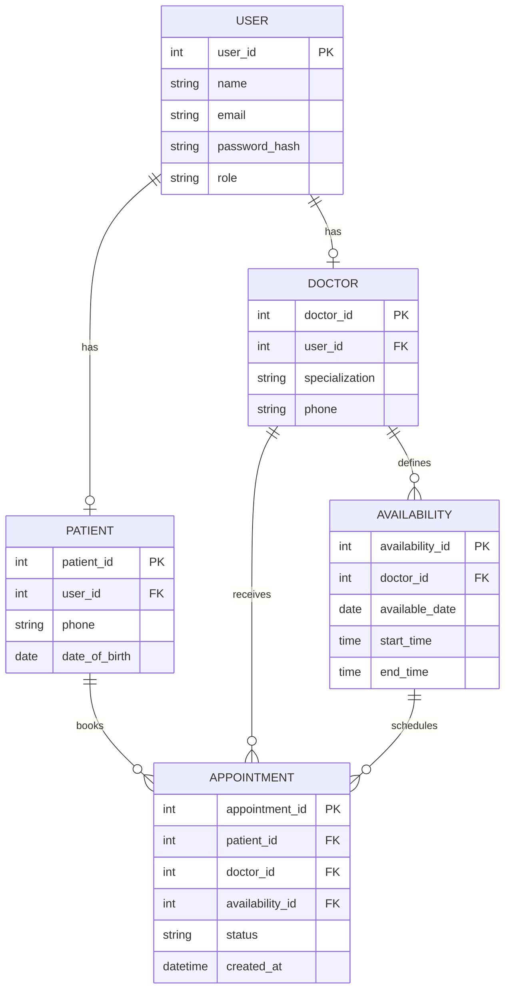

# Schedula Appointment Scheduling System
## Entity-Relationship (ER) Diagram

## Relationships

- A user account may be associated with a patient or doctor profile.
- A doctor can define multiple availability slots.
- A patient can book multiple appointments.
- A doctor can receive multiple appointments.
- Each appointment is associated with a patient, a doctor, and a scheduled slot.

## Notes

This is an initial schema and must be checked against the official Schedula API documentation before final approval.
